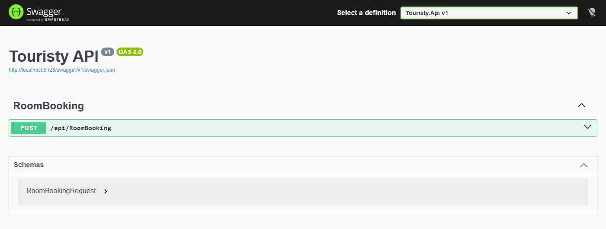
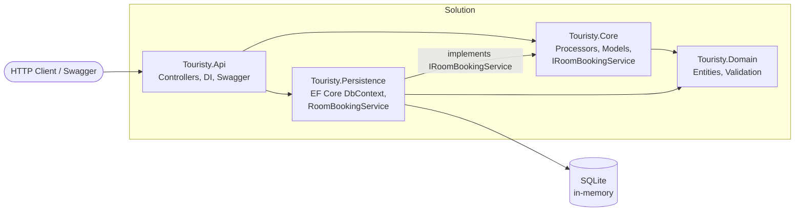

# Touristy

[](https://github.com/Ubaidurrehman10/Touristy/actions/workflows/dotnet.yml)


**A room-booking REST API built with ASP.NET Core and Clean Architecture, developed test-first (TDD).**



---

## Overview

Touristy lets a guest book a room for a given date. The API:

- checks which rooms are still free on that date,
- books the first available room and returns a booking ID,
- refuses the request when every room is taken (no double-booking), and
- rejects invalid input (missing name, malformed email, past date) with a clear `400 Bad Request`.

The project is mainly a showcase of **clean layering, dependency inversion and test-driven development** in modern .NET.

## Tech Stack

| Area            | Technology |
|-----------------|------------|
| Language / Runtime | C#, .NET 10 |
| Web framework   | ASP.NET Core Web API (controllers) |
| Data access     | Entity Framework Core 10 |
| Database        | SQLite (in-memory, created and seeded on startup) |
| API docs        | Swagger / OpenAPI (Swashbuckle) |
| Testing         | xUnit, Moq, Shouldly, EF Core InMemory provider |
| CI              | GitHub Actions (build + test on every push / PR to `main`) |

## Architecture

The solution follows a **Clean / Layered Architecture**. Business rules live in `Core` and depend only on abstractions; `Persistence` implements those abstractions, so the database can be swapped without touching business logic.



| Project | Responsibility |
|---------|----------------|
| `Touristy.Api` | HTTP endpoints, model-state validation, dependency injection, Swagger |
| `Touristy.Core` | Booking business logic (`RoomBookingRequestProcessor`), request/result models, the `IRoomBookingService` contract |
| `Touristy.Domain` | Entities (`Room`, `RoomBooking`) and shared validation rules (`RoomBookingBase`) |
| `Touristy.Persistence` | EF Core `TouristyAppDbContext`, seed data, migrations, `RoomBookingService` implementation |
| `*.Tests` | One test project per layer |

**Request flow:** `RoomBookingController` → `RoomBookingRequestProcessor` → `IRoomBookingService` → EF Core → SQLite

## Key Features & Engineering Highlights

- **Clean Architecture with dependency inversion:** `Core` defines `IRoomBookingService`; `Persistence` implements it, keeping business logic free of EF Core.
- **Double-booking prevention:** the processor saves a booking only when a room is free on the requested date and returns a `Success` / `Failure` flag.
- **Layered validation:** DataAnnotations (`[Required]`, `[StringLength]`, `[EmailAddress]`) plus `IValidatableObject` to reject past dates.
- **Consistent error handling:** invalid input and "no rooms available" both return `400 Bad Request` with a standard `ValidationProblemDetails` body.
- **Dependency injection:** scoped services wired in `Program.cs`.
- **EF Core:** code-first model, seed data (3 rooms), an initial migration, and SQLite in-memory storage for zero-setup runs.
- **Reusable mapping:** a generic `CreateRoomBookingObject<T>()` helper builds both the entity and the result from one request.
- **Test-Driven Development:** unit tests for every layer, using mocks (Moq), readable assertions (Shouldly) and the EF Core InMemory provider.
- **Continuous Integration:** GitHub Actions builds and tests every push and pull request to `main`.

## Getting Started

**Prerequisite:** [.NET 10 SDK](https://dotnet.microsoft.com/download)

```bash
git clone https://github.com/Ubaidurrehman10/Touristy.git
cd Touristy
dotnet run --project Touristy.Api --launch-profile http
```

Then open **http://localhost:5128/swagger** to try the API in your browser.

No environment variables, connection strings or migration steps are needed: the in-memory SQLite database is created and seeded automatically on startup.

Run the tests:

```bash
dotnet test
```

## API Documentation

| Method | Endpoint | Description |
|--------|----------|-------------|
| `POST` | `/api/RoomBooking` | Book the first available room for a date |

**Request**

```json
{
  "name": "Ubaid ur Rehman",
  "email": "ubaid@example.com",
  "date": "2027-01-15"
}
```

**200 OK** (room booked; `flag: 0` = `Success`)

```json
{
  "flag": 0,
  "roomBookingId": 1,
  "name": "Ubaid ur Rehman",
  "email": "ubaid@example.com",
  "date": "2027-01-15T00:00:00"
}
```

**400 Bad Request** (invalid input or no room available)

```json
{
  "title": "One or more validation errors occurred.",
  "status": 400,
  "errors": {
    "Email": ["The Email field is not a valid e-mail address."]
  }
}
```

Ready-to-run requests are in [`Touristy.Api/Touristy.Api.http`](Touristy.Api/Touristy.Api.http) (works in Visual Studio, Rider and the VS Code REST Client).

## Testing

| Test project | What it covers |
|--------------|----------------|
| `Touristy.Api.Tests` | Controller returns `200`/`400` correctly and only calls the processor for valid requests (mocked processor) |
| `Touristy.Core.Tests` | Booking rules: result mapping, null-request guard, saving only when a room is free, success/failure flag, booking ID |
| `Touristy.Persistence.Tests` | Available-room query and saving bookings against the EF Core InMemory provider |

```bash
dotnet test
```

## Project Structure

```
Touristy/
├── .github/workflows/dotnet.yml    # CI: build + test
├── Touristy.Api/                   # ASP.NET Core Web API
├── Touristy.Core/                  # Business logic & contracts
├── Touristy.Domain/                # Entities & validation
├── Touristy.Persistence/           # EF Core, migrations, repository
├── Touristy.Api.Tests/
├── Touristy.Core.Tests/
├── Touristy.Persistence.Tests/
└── Touristy.slnx
```

## Roadmap

- `GET` endpoints to list rooms and bookings
- Persistent database (SQL Server / PostgreSQL) via configuration
- Integration tests with `WebApplicationFactory`
- Authentication (JWT) for booking management
- Containerised deployment with a public Swagger demo

## Author

**Ubaid ur Rehman** · [GitHub](https://github.com/Ubaidurrehman10)
